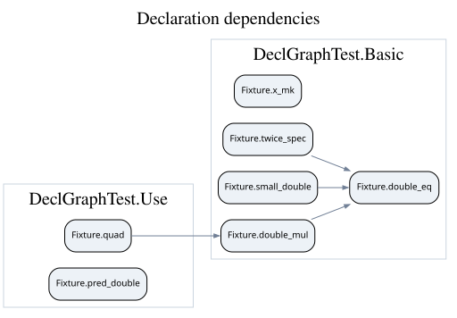

# declgraph

> [!NOTE]
> This entire project was generated by Claude.

Declaration-level dependency graphs for Lean 4 packages. `lake exe graph` from
[importGraph](https://github.com/leanprover-community/import-graph) draws module imports;
`lake exe declgraph` draws which theorems use which.



## Installation

Add the package to your `lakefile.toml`:

```toml
[[require]]
name = "declgraph"
git = "https://github.com/SamuelLess/declgraph"
rev = "main"
```

or to your `lakefile.lean`:

```lean
require declgraph from git "https://github.com/SamuelLess/declgraph" @ "main"
```

Then run `lake update declgraph`. The package depends only on Lean core (including Lake).

## Usage

Build your project, then run:

```
lake exe declgraph [OPTIONS] OUT.{dot,json}
```

| Option | Meaning | Default |
| --- | --- | --- |
| `--root M1,M2` | modules to import | the root modules of the package's default library targets |
| `--target D1,D2` | declarations to start from | every node |
| `--include P1,P2` | module prefixes that count as project code | the root modules of all the package's libraries |
| `--kind theorem\|all` | which declarations become nodes | `theorem` |
| `--reverse` | keep the dependents of the targets instead of their dependencies | |
| `--title T` | graph title | derived from the targets |

The format is chosen by the extension. Render a `.dot` file with Graphviz:
`dot -Tsvg OUT.dot -o OUT.svg`. Examples:

```sh
# Everything a theorem depends on
lake exe declgraph --target MyProject.main_theorem main.dot
# Everything that depends on a lemma
lake exe declgraph --reverse --target MyProject.key_lemma users.dot
# Definitions, structures and fields too
lake exe declgraph --kind all --include MyProject.Core core.json
```

## What the graph shows

An edge `A → B` means that the type or value of `A` mentions `B`, directly or through declarations
that are not nodes.

- **Nodes** are the declarations of the included modules that have a source position and are not
  generated by the compiler (auxiliary recursors, `match_`, `proof_`, equation lemmas, …).
  With `--kind theorem` (the default) only theorems are nodes. Structure fields are never
  theorem nodes, even when they are `Prop`-valued.
- **Folding.** Every other constant of the included modules (definitions, fields, generated
  helpers) is not drawn. Its dependencies are passed on to its users instead, and the search
  stops at the next node. Constants outside the included modules are not followed.
- **Targets** are always drawn, even if they are not nodes themselves.
- Since the graph is read from the compiled terms, a tactic such as `simp` counts as using every
  lemma that ends up in the proof term, and nothing else.

The `.dot` output has one cluster per module and highlights the targets. Each node's tooltip
gives its `file:line`, and the `_private` prefix is stripped from labels. The `.json` output has
the form `{title, nodes: [{name, label, module, kind, file, line, target}], edges: [{from, to}]}`.

## Development

`lake test` checks the graphs of the fixture in `DeclGraphTest` (known edges, a private lemma, a
folded definition, structure fields). It also checks that `examples/fixture.dot` is up to date;
to regenerate it:

```sh
lake build DeclGraphTest
lake exe declgraph --root DeclGraphTest --include DeclGraphTest examples/fixture.dot
dot -Tsvg examples/fixture.dot -o examples/fixture.svg
```
